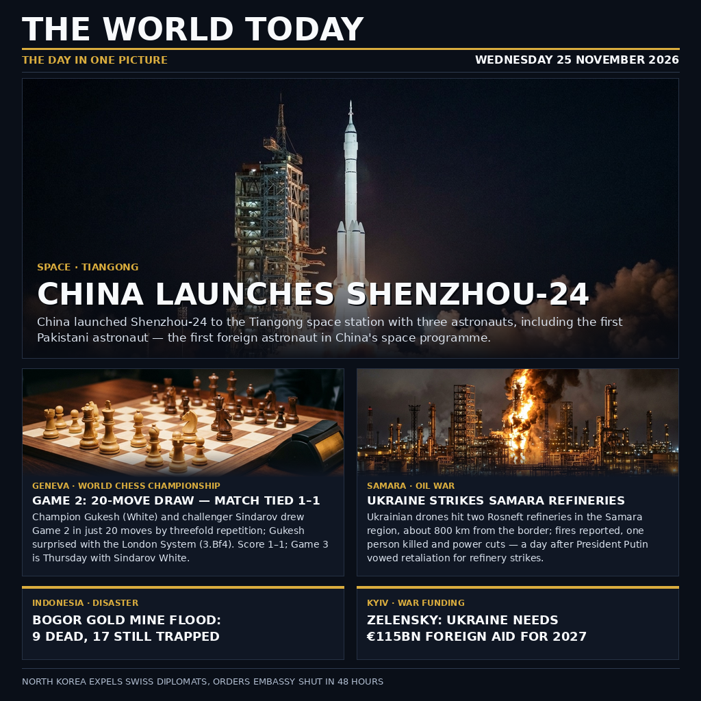

# The World Today — 25 November 2026

[](https://make.fun/competitions/news-image-20261125)
[](https://make.fun/competitions/news-image-20261125)
[](https://make.fun/competitions/news-image-20261125)

A single-image broadsheet front page summarizing the major world headlines of **Wednesday, 25 November 2026** for the `news-image-20261125` competition on [make.fun](https://make.fun/competitions/news-image-20261125).



## Stories Featured

- **Hero — China Launches Shenzhou-24 (`SPACE · TIANGONG`):** China launched the Shenzhou-24 crewed mission to the Tiangong space station with three astronauts aboard, including the first Pakistani astronaut — marking the first foreign astronaut to fly in China's human spaceflight programme. *(Sources: CMSA, Xinhua, Reuters)*
- **Left Panel — World Chess Championship Game 2 (`GENEVA · WORLD CHESS CHAMPIONSHIP`):** Defending champion Gukesh (White) and challenger Sindarov drew Game 2 in 20 moves by threefold repetition after Gukesh surprised with the London System (`3.Bf4`). The match stands tied 1–1 ahead of Thursday's Game 3 with Sindarov playing White. *(Sources: FIDE, Reuters)*
- **Right Panel — Ukraine Strikes Samara Refineries (`SAMARA · OIL WAR`):** Ukrainian long-range drones struck two Rosneft oil refineries in Russia's Samara region, roughly 800 km from the border, sparking fires, power cuts, and leaving one person dead — a day after President Putin vowed retaliation for refinery attacks. *(Sources: Reuters, regional emergency authorities)*
- **Brief 1 — Indonesia (`INDONESIA · DISASTER`):** Bogor gold mine flood leaves 9 dead and 17 still trapped. *(Sources: BNPB / local authorities, Reuters)*
- **Brief 2 — Ukraine Aid (`KYIV · WAR FUNDING`):** President Zelensky says Ukraine needs €115bn in foreign aid for 2027. *(Sources: Office of the President of Ukraine, Reuters)*
- **Footer — Diplomacy:** North Korea expels Swiss diplomats and orders the Swiss embassy shut within 48 hours. *(Sources: Swiss Federal Department of Foreign Affairs, Reuters)*

## Layout & Build

- `compose.py` deterministically renders `entry.png` at `1024×1024` using Pillow and system DejaVu Sans fonts from the existing editorial photography in `assets/` (`hero-space.jpg`, `panel-chess.jpg`, `panel-samara.jpg`).
- `main.py` is a Python standard-library entrypoint that copies `entry.png` into `$MAKEFUN_OUTPUT_DIR/entry.png` (defaulting to `/output/entry.png`), creating parent directories as needed.

```bash
python3 compose.py
MAKEFUN_OUTPUT_DIR=/tmp/out python3 main.py
```

## Verification

| Property | Value |
| --- | --- |
| File | `entry.png` |
| Format | PNG (RGB, `1024 × 1024`) |
| Byte Size | `747,240` bytes (< 1 MiB / `1,048,576` bytes) |
| SHA-256 | `b85e3fe50d5bf30ff7bb68349d8bf7095b93960f3c61fd3f3e8652184f003ac5` |
| Determinism | Verified byte-identical across repeated `compose.py` renders and `main.py` exports |
